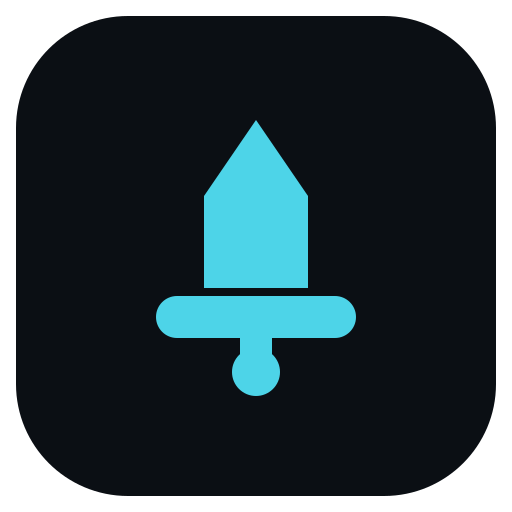

<p align="center">
  
</p>

# gladius

gladius is an MCP server that hands your agent a real headless browser: one native Rust binary over stdio, driving a pinned `chrome-headless-shell` directly over CDP, with no Node.js, no Playwright and no OS input anywhere in the runtime path.

## Install

Add the server to `opencode.jsonc`, then restart OpenCode:

```jsonc
{
  "mcp": {
    "servers": {
      "gladius": {
        "type": "local",
        "command": ["cmd", "/c", "npx", "-y", "gladius-mcp@latest"]
      }
    }
  }
}
```

Check the pin before you rely on it (prints the manifest and cache paths, downloads nothing, exits 0):

```powershell
npx -y gladius-mcp@latest --doctor
```

Your first real tool call provisions the pinned server runtime and the pinned browser, both hash-verified. Use `npx`, never `npm i -g` - global installs are refused by design.

## What it does

- Navigate and manage the session: `navigate`, `history`, `tabs`, `targets`, `viewport`, `dialog`, `close`.
- Read the page: `snapshot` (real Accessibility tree with stable `@eN` refs, pageable past the 8000-char cap), `evaluate`, `console`, `network`, `fetch_text`.
- Act on the page: `click`, `type`, `hover`, `select`, `key`, `upload` (trusted CDP input, `isTrusted:true`).
- Wait and prove layout: `wait_for`, `assert_layout`, `layout` (boxes and geometry, no pixels).
- Pixels: `screenshot` (deterministic, content checksum), `visual` (stored baselines, threshold diff).
- State: `storage` (cookies and Web Storage, versioned save/load).
- Escape hatch: `cdp` (raw CDP `method` + `params`).

That is 25 tools. Every tool carries a versioned `outputSchema` and `readOnly`/`destructive`/`idempotent`/`openWorld` annotations, and every failure returns a typed `structuredContent` code beside the prose.

## Requirements

Node 22.14 or newer, on Windows x64 - the first run downloads two hash-verified pinned artifacts, then reuses and re-verifies them.

Full tool signatures, options, environment variables, troubleshooting and limitations: [docs/GUIDE.md](docs/GUIDE.md).

## Development

```sh
cargo build --locked
cargo test --locked
```

`cargo fmt --all --check` and `cargo clippy --all-targets --locked -- -D warnings` are the static gate.

## Status

Experimental and still moving. It works today, but it is not a finished
product: interfaces may change, features may be improved or removed, and a
release can break the one before it. This is maintained by one person, not a
team. If it breaks, open an issue with the command you ran and what you saw.

## Links

- [Guide](docs/GUIDE.md)
- [Releases](https://github.com/nathwn12/gladius/releases)
- [MIT](LICENSE)

<!-- nathwn12 house footer: identical in every repo. Do not edit. -->
<p align="center">
  <a href="https://github.com/nathwn12"></a>
</p>
<p align="center">
  <sub>Built by <a href="https://github.com/nathwn12">nathwn12</a> · <a href="https://github.com/nathwn12?tab=repositories">All projects</a></sub>
</p>
