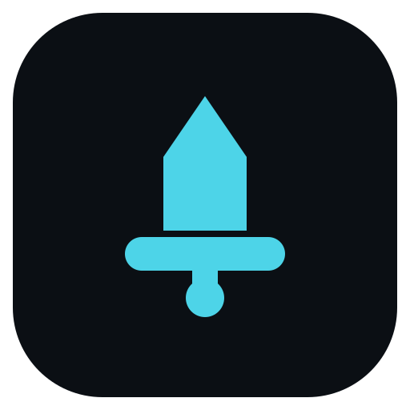

<p align="center">
  
</p>

<h1 align="center">gladius</h1>

<p align="center"><strong>An MCP server that gives your agent a real headless browser, driven directly over CDP by one native binary.</strong></p>

<p align="center">
  <a href="https://www.npmjs.com/package/gladius-mcp"></a>
  
  
  
</p>

One stdio connection. One native binary. One pinned browser.

- **Browser**: navigate, snapshot, click, type, screenshot and assert layout over CDP.
- **Agent-ready**: every tool carries a versioned output schema and typed annotations, so a code-mode host builds a typed API.
- **Evidence, not vibes**: layout checks report measured boxes; deterministic screenshots carry a content checksum.

## Why gladius

Most browser MCPs wrap a heavyweight driver and leave the agent guessing about page state. gladius gives stable `@eN` refs, geometry checks and deterministic captures over one connection.

- **No pointer steal.** Every action rides CDP: no OS cursor, no window, no foreground tab.
- **Refs that fail typed.** `snapshot` returns stable `@eN` refs; a stale ref is a typed error, not a click on the wrong element.
- **Proof in the result.** `assert_layout` measures boxes and geometry; `visual` diffs stored baselines by threshold.
- **One binary, no sidecar.** The runtime zip ships inside the npm tarball; the launcher provisions and sha256-verifies it plus the browser on first run, then reuses both.
- **Bring your own browser.** Set `GLADIUS_CDP_URL` to drive an engine you already run; `close` detaches and never kills it.

## Install

Add the server to your MCP client and restart it:

```jsonc
{
  "$schema": "https://opencode.ai/config.json",
  "mcp": {
    "servers": {
      "gladius": {
        "type": "local",
        "command": ["cmd", "/c", "npx", "-y", "gladius-mcp@latest"]
      }
    }
  }
}
```

The client spawns npx, which runs the bundled launcher and speaks MCP over stdio. The first tool call provisions the runtime from the zip inside that npm tarball and the browser from Google; both are sha256-verified before and after extraction. npm is the release: no GitHub Release page is involved. A global install is refused by the package's `preinstall` script.

Check the pin without downloading anything: `npx -y gladius-mcp@latest --doctor` prints the manifest and resolved cache paths and exits 0.

Use `@latest`. Only a published tarball that actually carries the runtime zip under `bin/` is supported; verify it before pinning an exact version. npm versions are immutable: versions published before bundling cannot gain the zip and are legacy and unsupported - their manifest URL points at an empty Releases page, so that fallback may 404.

## Use it

Ask the agent to open a page, take a snapshot, then act on a ref. The loop is the same for every task: navigate, snapshot, then a tool that acts on an `@eN` ref.

```js
await navigate({ url: "http://localhost:3000" });
const snap = await snapshot();
await click({ element: "@e12" });
await wait_for({ selector: ".done" });
const shot = await screenshot({ deterministic: true });
```

## Tools

Twenty-five tools, each with a versioned output schema and `readOnly`/`destructive`/`idempotent`/`openWorld` annotations. Every failure returns a typed code beside the prose.

- Navigate and inspect: `navigate`, `history`, `tabs`, `targets`, `viewport`, `dialog`, `close`
- Read: `snapshot` (the accessibility tree with stable `@eN` refs, pageable past 8000 chars), `evaluate`, `console`, `network`, `fetch_text`
- Act: `click`, `type`, `hover`, `select`, `key`, `upload` (trusted CDP input, `isTrusted:true`)
- Wait and prove: `wait_for` (selector, text, expression or network idle), `assert_layout`, `layout` (boxes and geometry, no pixels)
- Pixels: `screenshot` (deterministic, with a content checksum), `visual` (stored baselines, threshold diff)
- State: `storage` (cookies and Web Storage, versioned save and load)
- Escape hatch: `cdp` (raw `method` plus `params`)

Every argument, option and typed error: [docs/GUIDE.md](docs/GUIDE.md).

## Compatibility

Any MCP client that speaks stdio can spawn gladius. The launcher is published as `gladius-mcp` on npm; the server binary is provisioned on first use.

To drive a browser you already run, set `GLADIUS_CDP_URL` to its CDP endpoint. gladius attaches without launching or killing it, and `close` detaches only the session it opened. Headless only: gladius never opens a visible window.

## Configure it

No flag serves MCP. The launcher's other flags are `--doctor`, `--print-manifest`, `--version` and `--help`.

| Variable | Default | Effect |
| --- | --- | --- |
| `GLADIUS_CDP_URL` | unset | Attach to an engine you already run instead of launching one; `close` detaches and never kills it. |
| `GLADIUS_CHROMIUM` | unset | Absolute path to your own `chrome-headless-shell`; browser provisioning is skipped entirely. |
| `GLADIUS_VISUAL_DIR` | per-user cache, under `gladius/visual` | Root for `visual` baselines and their sidecars. |
| `GLADIUS_VISUAL_CAP` | `500` | Stored baselines, and separately the diff by-products. A save at the cap is a typed refusal. |
| `GLADIUS_TOOL_BUDGET_MS` | `90000` | Budget for one tool call; a per-call `_budgetMs` overrides it. |
| `GLADIUS_STARTUP_TIMEOUT_SECS` | `30` | Deadline for the owned-engine readiness poll. |
| `GLADIUS_BACKEND_CAPS` | `render` | `dom-only` makes `screenshot` and `visual` refuse with a typed error instead of returning a fake image. |

Attach to a browser you run yourself, so the engine is yours and gladius only drives it. Add this to the `gladius` entry from Install:

```jsonc
"environment": { "GLADIUS_CDP_URL": "http://127.0.0.1:9222" }
```

## Requirements

- Windows 10/11 x64. The server runtime runs on no other platform.
- Node 22.14 or newer, for the `npx` launcher.
- An MCP client that speaks stdio.
- The server runtime ships in the npm tarball and provisions offline. Only the pinned browser is fetched from Google on first run; set `GLADIUS_CHROMIUM` to an existing binary to skip that.
- Headless only: gladius never opens a visible window. To watch a real browser, start your own and attach with `GLADIUS_CDP_URL`.

## Development

```sh
cargo build --locked
cargo test --locked
```

The toolchain is pinned by `rust-toolchain.toml`. `cargo fmt --all --check` and `cargo clippy --all-targets --locked -- -D warnings` are the static gate. Architecture, budgets and the frozen tool contract: [docs/ARCHITECTURE.md](docs/ARCHITECTURE.md). Release lane: [docs/PUBLISHING.md](docs/PUBLISHING.md).

## Status

**Experimental** — pre-release; interfaces may change.

## Links

- [Issues](https://github.com/nathwn12/gladius/issues)
- [Version tags](https://github.com/nathwn12/gladius/tags) (history markers only; npm is the release)
- [Guide](docs/GUIDE.md)
- [Architecture](docs/ARCHITECTURE.md)
- [Publishing](docs/PUBLISHING.md)
- [Third-party notices](THIRD-PARTY-NOTICES.md)
- [MIT](LICENSE)

<p align="center"><sub>Built by nathwn12</sub></p>
