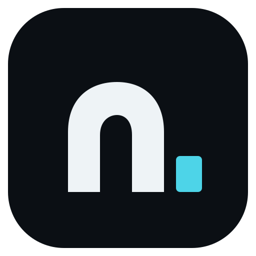

# gladius-mcp

MCP browser-use server: a native Rust binary driving the owned pinned
Chromium (`chrome-headless-shell`) over CDP, served over stdio. This package
is a dependency-free Node launcher plus a pinned browser/runtime manifest —
it contains no browser bytes and no server bytes.

<p align="center">
  <a href="https://www.npmjs.com/package/gladius-mcp"></a>
  
  
  
</p>

## Run

```sh
npx gladius-mcp@latest
```

Or pin it in an MCP client as a stdio server with command `npx` and args
`["gladius-mcp@latest"]`.

First run provisions two things, both sha256-verified before and after
extraction: the pinned server runtime from the tagged GitHub Release into
`%LOCALAPPDATA%\gladius\engine\<serverVersion>-<bundleSha8>\`, and the
pinned browser from Google's Chrome-for-Testing endpoint (~120 MB download)
into `%LOCALAPPDATA%\gladius\chromium\<version>-<zipSha8>\`. Both are reused
on later runs (re-verified each time); any mismatch refuses and writes
nothing. An explicit `GLADIUS_CHROMIUM` binary wins instead: on that path no
browser is provisioned at all. All launcher chatter goes to stderr; stdout
belongs to the MCP channel.

## Diagnostics (no network)

```sh
npx gladius-mcp@latest --doctor
```

Prints the pinned manifest and the resolved cache paths, exits 0, performs
no fetch. `--print-manifest` is an alias.

## Overrides

Use `npx gladius-mcp@latest`; a pinned version is only installable while its
GitHub release exists; the one-release policy deletes older releases.

## Requirements

- Windows x86_64. Any other platform refuses at startup
  (override for diagnostics only: `GLADIUS_MCP_ALLOW_NON_WINDOWS=1`).
- Node.js >= 22.14.0 (global `fetch` plus `crypto`/`zlib` builtins only;
  zero dependencies).

## Browser provenance

The browser is Chrome-for-Testing `chrome-headless-shell` `156.0.8078.80`
(headless-only), fetched at provision time from
`https://storage.googleapis.com/chrome-for-testing-public/156.0.8078.80/win64/chrome-headless-shell-win64.zip`.
It is NEVER redistributed in our release assets or this package: our own
manifest is the integrity root (CfT publishes no hashes), and the in-package
manifest pins the archive hash, the extracted tree's file count + total size,
and every per-file sha256. The runtime bundle carries the Chromium licence
attribution copy (`THIRD-PARTY-LICENSES/LICENSE.headless_shell`).

## Full documentation

https://github.com/nathwn12/gladius/blob/main/README.md
https://www.npmjs.com/package/gladius-mcp

## License

MIT - see LICENSE.

<p align="center">
  
  <br />Built by nathwn12
</p>
